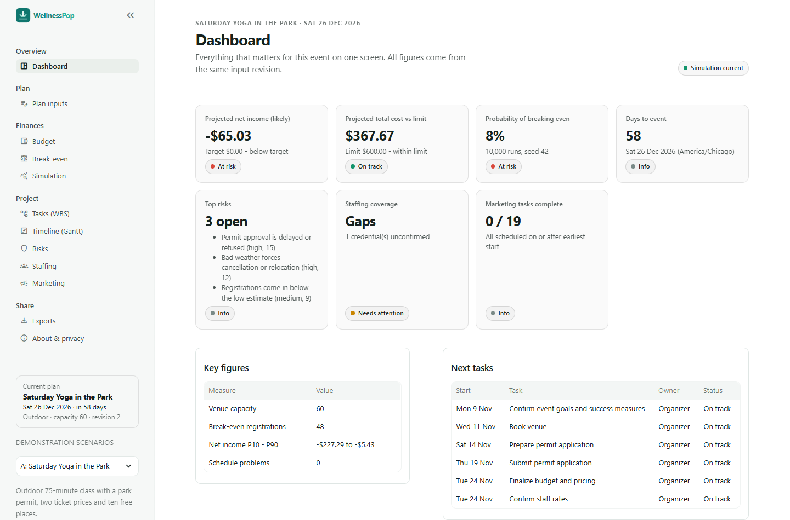

# WellnessPop

A free web app that helps community wellness organizers (independent instructors, small collectives, community organizations and nonprofit program staff) turn event assumptions into an actionable project plan and a defensible financial forecast.

Enter or import your event, venue, costs, pricing, attendance, staffing and marketing assumptions, or start from one of three demonstration scenarios. WellnessPop produces ten outputs from one consistent model:

1. **Budget**: fixed and variable costs, revenue by ticket tier and other sources, low / likely / high net income
2. **Work breakdown structure (WBS)**: editable three-phase task list generated from your inputs
3. **Gantt schedule**: tasks scheduled backward from the event date, with a today marker
4. **Break-even**: registrations, on-site attendance and price needed, each explained in one sentence
5. **Simulation**: 10,000+ Monte Carlo runs with a fixed seed, probability of breaking even, P10/P50/P90, histogram and tornado chart
6. **Risk register**: likelihood × impact scores with owner roles, responses and status
7. **Staffing**: role costs, coverage recommendations and credential gaps, linked to the budget
8. **Marketing schedule**: backward-planned activities per channel, downloadable as CSV
9. **Dashboard**: seven measures on one screen, all from the same input revision
10. **Exports**: an eight-sheet Excel workbook and a one-page PDF summary

No accounts, no database, no paid services, and no calls to outside APIs. Plans live in server memory for your browser session only.



More screenshots (local run, 29 October 2026): [welcome](docs/screenshots/welcome.png), [budget](docs/screenshots/budget.png), [timeline](docs/screenshots/gantt.png), [simulation](docs/screenshots/simulation.png), [inputs](docs/screenshots/inputs.png), [exports](docs/screenshots/exports.png), [dark theme](docs/screenshots/dark.png), [phone](docs/screenshots/phone.png).

## Run locally (Windows, 8 steps)

1. Install Python 3.12 (free, from python.org or `winget install Python.Python.3.12`).
2. Open PowerShell in this folder.
3. `python -m venv .venv`
4. `.\.venv\Scripts\python.exe -m pip install --upgrade pip`
5. `.\.venv\Scripts\python.exe -m pip install -r requirements-dev.txt`
6. `.\.venv\Scripts\python.exe -m pytest` (optional: runs the test suite)
7. `.\.venv\Scripts\python.exe -m streamlit run app.py`
8. Open http://localhost:8501 and choose a demo on the welcome panel (or in the sidebar).

On macOS/Linux, use `python3` and `.venv/bin/python` instead of `.\.venv\Scripts\python.exe`.

## Project layout

```text
app.py                  Streamlit entry point (theme, navigation, sidebar)
views/                  One small script per page (used by st.navigation)
wellnesspop/            Calculation modules (no Streamlit imports outside ui/)
  schema.py validation.py   Input contract and validation
  budget.py                 Shared financial evaluator, budget, break-even
  simulation.py             Vectorized Monte Carlo and tornado sensitivity
  schedule.py risk.py staffing.py marketing.py dashboard.py
  planner.py state.py       One immutable snapshot per revision; session state
  imports.py export.py      CSV/XLSX import; XLSX/PDF/CSV export
  ui/                       Streamlit pages and Plotly charts
  templates/                Public task, risk, role and marketing templates
data/demo/              Three demonstration scenarios
tests/                  pytest suite (calculations, imports, exports, privacy, UI)
docs/                   Decisions, assumptions, schema, user guide, deployment, project plan
```

## Documentation

- [User guide](docs/user-guide.md) and [simulation explainer](docs/simulation-explainer.md)
- [Decision log](docs/decisions.md) and [assumptions and provenance](docs/assumptions.md)
- [Input schema](docs/input-schema.md) (generated: `python -m scripts.generate_schema_doc`)
- [Deployment to free Streamlit Community Cloud and its privacy limits](docs/deployment.md)
- [Product requirements](docs/prd.md), [deferred work](docs/later.md), [project plan](docs/project-plan/)

## Project window

Original brief schedule: 25 September – 20 November 2026 (seven gates plus a buffer week). The MVP code was built on 29 October 2026; gate dates need to be rebaselined with the project owner (see `docs/project-plan/gate-reviews.md`).

## Status and limits

- Forecasts are only as good as the assumptions entered and are not guarantees.
- Demo amounts are **illustrative**, not researched Chicago rates.
- Hybrid events use a whole-event weather cancellation approximation.
- Hosting on Streamlit Community Cloud means the platform collects usage statistics the app cannot turn off; see [deployment](docs/deployment.md).

## Licenses

Built only with free, open-source software: Python, Streamlit, pandas, NumPy, SciPy, Plotly, openpyxl, fpdf2, tzdata and pytest (their licenses apply). The bundled DejaVu Sans fonts are under the license in `wellnesspop/fonts/LICENSE_DEJAVU`. Project ownership and credit follow the fellowship terms; no software license has been chosen for this repository yet.
